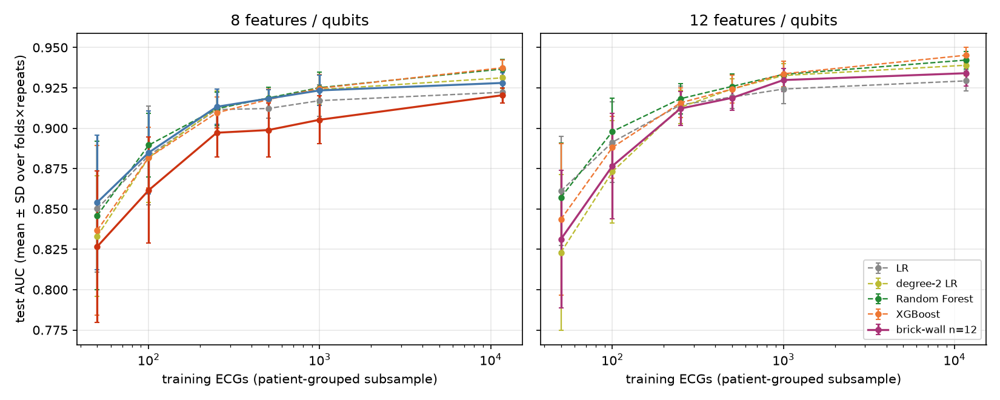

# BRICKWALL — Antonio's magic-state brick-wall QNN vs tuned classical models on PTB-XL (MI vs NORM)

Branch `brickwall-overnight`. Chronological log: [`OVERNIGHT_LOG.md`](OVERNIGHT_LOG.md). This report is updated after every phase.
Status: **P0–P7 ✔; EXTRA 1–5 ✔ except where marked pending in the EXTRA section** (see OVERNIGHT_LOG.md for what finished last).

## Headline (best quantum vs best classical; advantage rule applied)

| features | best classical (5-fold test AUC) | best quantum (5-fold test AUC) | gap | advantage rule |
|---|---|---|---|---|
| 8 | XGBoost 0.9374 ± 0.0049 (RF 0.9367, MLP 0.9336, LR2 0.9312, LR 0.9222) | angle VQC π/6 0.9280 ± 0.0063; brick-wall n=8 0.9204 ± 0.0047 | −0.009 / −0.017 | **not met** (brick-wall ≈ LR: 3/5 folds, CI [−0.004, +0.0004]) |
| 12 | XGBoost 0.9452 ± 0.0050 (RF 0.9422, MLP 0.9416, LR2 0.9390, LR 0.9293) | brick-wall n=12 0.9341 ± 0.0079 (no 12-feature angle VQC exists) | −0.011 | **not met** (beats LR by +0.0047, CI [+0.003, +0.0065], 4/5 folds; loses to LR2/MLP/RF/XGB) |
| 32 | XGBoost 0.9647 ± 0.0046 (RF 0.9608, MLP 0.9597, LR2 0.9583, LR 0.9451) | angle VQC π/6 0.9510 ± 0.0059; trained scales 0.9547 ± 0.0051 | −0.014 / −0.010 | **not met** (beats LR, loses to the rest) |
| external PTB (n = 445 records, 52 healthy + 148 MI patients) | k=8: LR 0.912; k=12: LR 0.921; k=32: XGBoost 0.946 (CIs ±0.03) | angle VQC k=8 0.909, brick-wall n=8 0.903, n=12 0.910; angle VQC k=32 0.934 | −0.003 … −0.013 | **not met** (every CI of the difference includes 0 at k = 8, 12; XGBoost significantly better than the angle VQC at k = 32) |

* **No quantum model outperforms the tuned classical baselines on any feature set**, in cross-validation or externally. At best a quantum model ties logistic regression (brick-wall n=8) or beats plain LR (brick-wall n=12, angle VQCs at k=32) while degree-2 LR, MLP, RF and XGBoost remain ahead. This is an empirical statement on this task, in simulation, with these grids.
* **Simulability note (paper Prop. 8, Sec. VI.B–C):** two-body nearest-neighbour expectation values of this encoding are additively classically tractable at every particle number; our simulator uses exactly that structure (sector dimension ≤ 924), so even a quantum performance advantage on this readout would not have implied hardness. The paper's hardness claims concern sampling (sample-level head, EXTRA 2).
* **XGBoost on all 249 features reaches 0.973** (sens@90% spec 0.924); fewer features (8/12, the quantum-friendly regime) cost 0.03–0.04 AUC for every model.
* **π/6 lesson transfers qualitatively:** small phase scales (π/6–π/4) beat the paper's π scaling; π is worst everywhere (P3).
* **Hardware readiness:** the n=8 brick-wall is robust to shots, FakeFez noise and post-selection (AUC 0.915 → 0.911); the n=12 model needs ~10⁶ shots because its head amplifies shot noise (P6).
* **Extractor issue found and fixed:** the stored ST features come from a 0.5–40 Hz filter, not the script's current 0.05 Hz one; the recovered version reproduces the table to 1e-13 (P4). A real V4–V6 population shift between PTB-XL and PTB healthy controls remains.

## P0 — setup and sanity

* Environment: `../.venv` (Python 3.14.3, numpy 2.4.6, scikit-learn 1.9.0, xgboost 3.4.1, wfdb 4.3.1) for all classical work, feature extraction and the angle VQC;
  `C:\bwvenv` (torch 2.15.0+cpu, pennylane 0.43.3, qiskit 2.6.2, qiskit-aer 0.18.2, qiskit-ibm-runtime 0.52.0) for the brick-wall simulator and hardware prep.
  (`import torch` is blocked by Windows Application Control inside the OneDrive `.venv`, and some sklearn/pandas DLLs are intermittently blocked in `C:\bwvenv`;
  the torch workers therefore use only numpy + torch and read pre-computed arrays from `C:\bwcache`.) 16 cores; only ~1 GB RAM was free, so ≤ 4 workers ran at a time.
* Sanity: fold-0 k=32 π/6 test AUC recomputed from the stored parameters with `scale_cv.prep()` = **0.959758698692389**, identical to the logged value (`p0_sanity.py`).

## P1 — classical benchmarks (5-fold patient-grouped CV, hyper-parameters chosen on validation AUC)

Models: LR (C grid), degree-2 LR (C grid), Random Forest (n_estimators {300,800} × max_depth {None,8,16} × min_samples_leaf {1,5}), XGBoost (depth {3,5,7} ×
learning rate {0.03,0.1}, ≤ 800 trees, early stopping on validation, subsample = colsample = 0.8), MLP (hidden 8/16/32 × L2 {1e-4,1e-2} × 2 seeds, early stopping).
k features come from the L1 path of the inner-train fold (`cohen_dedup` also at k = 8, 12). Degree-2 LR is skipped at k=249 (31k features).
Rows labelled "existing" are our earlier angle-VQC runs (1000 steps, same folds; `results/n4_clinical.json`). Code `p1_classical.py`, data `results/p1_classical.jsonl`.

| selector | k | model | test AUC (mean ± SD, 5 folds) | sens @ 90% spec | val AUC | folds |
|---|---|---|---|---|---|---|
| l1 | 8 | LR | 0.9222 ± 0.0067 | 0.786 | 0.9247 | 5 |
| l1 | 8 | degree-2 LR | 0.9312 ± 0.0067 | 0.806 | 0.9335 | 5 |
| l1 | 8 | Random Forest | 0.9367 ± 0.0058 | 0.820 | 0.9396 | 5 |
| l1 | 8 | XGBoost | 0.9374 ± 0.0049 | 0.817 | 0.9421 | 5 |
| l1 | 8 | MLP (8/16/32) | 0.9336 ± 0.0075 | 0.809 | 0.9365 | 5 |
| l1 | 8 | **angle VQC π/6 (ours, existing)** | 0.9280 ± 0.0063 | 0.796 | – | 5 |
| l1 | 12 | LR | 0.9293 ± 0.0064 | 0.801 | 0.9318 | 5 |
| l1 | 12 | degree-2 LR | 0.9390 ± 0.0067 | 0.828 | 0.9410 | 5 |
| l1 | 12 | Random Forest | 0.9422 ± 0.0055 | 0.836 | 0.9457 | 5 |
| l1 | 12 | XGBoost | 0.9452 ± 0.0050 | 0.838 | 0.9483 | 5 |
| l1 | 12 | MLP (8/16/32) | 0.9416 ± 0.0064 | 0.832 | 0.9442 | 5 |
| l1 | 16 | LR | 0.9320 ± 0.0075 | 0.816 | 0.9355 | 5 |
| l1 | 16 | degree-2 LR | 0.9465 ± 0.0062 | 0.853 | 0.9497 | 5 |
| l1 | 16 | Random Forest | 0.9492 ± 0.0055 | 0.862 | 0.9518 | 5 |
| l1 | 16 | XGBoost | 0.9518 ± 0.0041 | 0.866 | 0.9555 | 5 |
| l1 | 16 | MLP (8/16/32) | 0.9489 ± 0.0061 | 0.857 | 0.9526 | 5 |
| l1 | 16 | **angle VQC π/6 (ours, existing)** | 0.9395 ± 0.0056 | 0.826 | – | 5 |
| l1 | 32 | LR | 0.9451 ± 0.0082 | 0.848 | 0.9475 | 5 |
| l1 | 32 | degree-2 LR | 0.9583 ± 0.0044 | 0.884 | 0.9585 | 5 |
| l1 | 32 | Random Forest | 0.9608 ± 0.0053 | 0.896 | 0.9619 | 5 |
| l1 | 32 | XGBoost | 0.9647 ± 0.0046 | 0.903 | 0.9650 | 5 |
| l1 | 32 | MLP (8/16/32) | 0.9597 ± 0.0052 | 0.885 | 0.9620 | 5 |
| l1 | 32 | **angle VQC π/6 (ours, existing)** | 0.9510 ± 0.0059 | 0.856 | – | 5 |
| l1 | all 249 | LR | 0.9534 ± 0.0071 | 0.873 | 0.9566 | 5 |
| l1 | all 249 | Random Forest | 0.9666 ± 0.0039 | 0.902 | 0.9678 | 5 |
| l1 | all 249 | XGBoost | 0.9731 ± 0.0029 | 0.924 | 0.9745 | 5 |
| l1 | all 249 | MLP (8/16/32) | 0.9631 ± 0.0047 | 0.892 | 0.9660 | 5 |
| l1 | 32 | **angle VQC, trained scales (existing)** | 0.9547 ± 0.0051 | 0.867 | – | 5 |
| cohen_dedup | 8 | LR | 0.9150 ± 0.0076 | 0.771 | 0.9150 | 5 |
| cohen_dedup | 8 | degree-2 LR | 0.9213 ± 0.0073 | 0.789 | 0.9216 | 5 |
| cohen_dedup | 8 | Random Forest | 0.9231 ± 0.0076 | 0.796 | 0.9247 | 5 |
| cohen_dedup | 8 | XGBoost | 0.9232 ± 0.0069 | 0.791 | 0.9273 | 5 |
| cohen_dedup | 8 | MLP (8/16/32) | 0.9222 ± 0.0081 | 0.794 | 0.9237 | 5 |
| cohen_dedup | 12 | LR | 0.9235 ± 0.0060 | 0.789 | 0.9248 | 5 |
| cohen_dedup | 12 | degree-2 LR | 0.9369 ± 0.0044 | 0.822 | 0.9377 | 5 |
| cohen_dedup | 12 | Random Forest | 0.9423 ± 0.0048 | 0.838 | 0.9443 | 5 |
| cohen_dedup | 12 | XGBoost | 0.9435 ± 0.0035 | 0.830 | 0.9468 | 5 |
| cohen_dedup | 12 | MLP (8/16/32) | 0.9406 ± 0.0048 | 0.830 | 0.9414 | 5 |

**Reading.** More features help every model; the tree ensembles gain the most (XGBoost 0.937 → 0.973 from k=8 to all 249 features).
Selection by L1 beats `cohen_dedup` at k=8, and they tie at k=12. At k=8 the quantum-friendly benchmark to beat is **0.937 (XGBoost/RF)**, at k=12 **0.945 (XGBoost)**.

## P2 — the brick-wall QNN rebuilt and verified (reconstruction of `quantum_utils.py`)

`quantum_utils.py` was **not supplied**, so `bw_utils.py` is a **reconstruction** (clearly *not* Antonio's code) from the paper and the notebook's call signatures:

| function | our reconstruction | confidence |
|---|---|---|
| `particle_count(n, k)` | explicit k must be even, 2k ≤ n (k/2 magic blocks of 4 qubits). Default (k=None) guessed as `max(2, 2·(n//8))`: gives k=2 at n=8 (matches the notebook output "features=8, k=2"), k=2 at n=12 | **low** for n=12 |
| `spreading_matrix(n)` | single-particle unitary with |W_ij|² = 1/n: Walsh–Hadamard (n=8), real Hadamard matrix of order 12 (Paley construction) at n=12 | medium (see finding) |
| `UniformSpreading(W, wires)` | exact many-body (Jordan–Wigner, passive free-fermion) action of W on the k-particle space: amplitude of Fock state T = Σ_S ψ_in(S)·det W[T,S] | medium |
| `initial_weights(n, columns, rng)` | N(0, 0.1²) of shape (columns, 3n/2); first n/2 entries per column = RBS angles, last n = Rz phases (as indexed in `make_circuit`) | high (shape), low (distribution) |
| `shift_coefficients(k)` | equidistant-frequency parallel parameter-shift rule, shifts (2m−1)π/(4k); **not used** (we train with exact autograd) | low, unused |

**Finding on the spreading circuit.** The paper (Sec. III.D) says the *fixed-angle brick-wall* (n−1 columns of chain-pair RBS at π/4, boundary pair and Rz = 0) implements the
Walsh–Hadamard transform. Built literally, that circuit is orthogonal but **not** uniform-modulus (max |(|W_ij|² − 1/n)| = 0.35 at n=8, 0.40 at n=12), so it does *not* give the
Lemma-2 occupation k/n. We therefore use the exact Walsh–Hadamard / Hadamard-12 matrix and compile it exactly into n(n−1)/2 nearest-neighbour RBS gates + a ±1 sign layer
(`hw_bw.givens_decompose`; 28 RBS at n=8, 66 at n=12). Worth asking Antonio which circuit the notebook's `UniformSpreading` really uses.
n=12 is not a power of two, so a Walsh–Hadamard transform does not exist there; the order-12 Hadamard matrix is our substitute (the DFT would be the other uniform option).

**Fast simulator** (`bw_torch.py`): |φ0⟩ = U_had|Ψ_in⟩ is data-independent, so it is precomputed once in the k-particle sector (dimension C(n,k): 28–70 at n=8, 66–924 at n=12);
|ψ(x)⟩ = U_cols(w)·D(φ(x))|φ0⟩ with D an elementwise phase and U_cols the RBS/Rz columns acting inside the sector, with the notebook's conventions
(RZ(−φ), RZ(−w), SingleExcitation(−2w), ring pairs on odd columns). Readout m_j = ⟨n_j n_{j+1}⟩ (ring), f = 4m, linear head + sigmoid. complex128 for checks, complex64 for training; gradients by autograd.

**Verification** (`p2_verify.py`; 20 random (x, w) per row, 2 columns; the reference is an independent dense 2ⁿ gate-level simulation, with U_had applied as the exact
free-fermion unitary exp(Σ log W_ij a†_i a_j) by sparse exponentials, and the notebook's own `make_circuit` gate sequence in PennyLane 0.43.3):

| n | k | state vs dense (numpy sector, incl. phase) | torch c128 vs dense (up to phase) | features vs dense | PennyLane (notebook circuit) features | weight leakage | Lemma 2 max dev (after spreading / after data) | grad vs finite diff |
|---|---|---|---|---|---|---|---|---|
| 8 | 2 | 9.1e-16 | 6.8e-16 | 1.0e-15 | 2.8e-16 | 0e+00 | 1.1e-16 / 1.1e-16 | 8.2e-11 |
| 8 | 4 | 1.3e-15 | 8.9e-16 | 5.1e-15 | 4.4e-16 | 0e+00 | 2.2e-16 / 1.7e-16 | 9.3e-11 |
| 12 | 2 | 5.6e-16 | 5.1e-16 | 8.3e-16 | 8.3e-17 | 0e+00 | 1.4e-16 / 1.4e-16 | 1.0e-10 |
| 12 | 4 | 4.1e-16 | 3.5e-16 | 2.1e-15 | 2.8e-16 | 0e+00 | 9.4e-16 / 9.4e-16 | 1.6e-10 |
| 12 | 6 | 3.1e-16 | 3.1e-16 | 4.7e-15 | 8.9e-16 | 0e+00 | 1.4e-15 / 1.4e-15 | 5.7e-10 |

All state errors ≤ 1.3e-15 (required < 1e-10), particle number exact (no weight leakage), Lemma-2 occupations k/n to 1.4e-15, gradients within 2.3e-10 of finite differences (required < 1e-6).

**Toy XOR from the notebook** (`p2_xor_facts.py`, same data generator and loop — batch 8, 100 steps, quantum LR 0.5, head LR 1.0, one column per step — but with the **exact** gradient instead of
the stochastic parallel parameter-shift estimate): default seed (42+n) 100.0% (n=8, 2 columns, k=2) and 100.0% at n=12; averaged over 10 other seeds **52.9%** (range 50–67%);
300 steps: 89.6%. The notebook's saved **72.9%** is not reproduced exactly and cannot be: our weight initialisation, particle-number handling and gradient estimator differ
(the PSR is stochastic and the initial weights come from the unknown `initial_weights`). The accuracy on this tiny task is dominated by initialisation (it is a 96-sample, 100-step problem), so 72.9% sits inside the seed spread of our rerun.

**Circuit facts** (nearest-neighbour hardware; magic preparation depth 4; Hadamard spreading compiled as n(n−1)/2 RBS gives depth ≈ n+... — depth column uses the paper's nearest-neighbour spreading depth n−1):

| qubits | columns | particle number k | magic blocks | sector dim C(n,k) | trainable RBS | trainable Rz | circuit params | depth (NN: magic 4 + spread n−1 + data 1 + 2·cols) | spreading RBS (Givens) |
|---|---|---|---|---|---|---|---|---|---|
| 8 | 2 | 2 | 1 | 28 | 8 | 16 | 24 | 16 | 28 |
| 8 | 2 | 4 | 2 | 70 | 8 | 16 | 24 | 16 | 28 |
| 8 | 4 | 2 | 1 | 28 | 16 | 32 | 48 | 20 | 28 |
| 8 | 4 | 4 | 2 | 70 | 16 | 32 | 48 | 20 | 28 |
| 8 | 8 | 2 | 1 | 28 | 32 | 64 | 96 | 28 | 28 |
| 8 | 8 | 4 | 2 | 70 | 32 | 64 | 96 | 28 | 28 |
| 12 | 2 | 2 | 1 | 66 | 12 | 24 | 36 | 20 | 66 |
| 12 | 2 | 4 | 2 | 495 | 12 | 24 | 36 | 20 | 66 |
| 12 | 2 | 6 | 3 | 924 | 12 | 24 | 36 | 20 | 66 |
| 12 | 4 | 2 | 1 | 66 | 24 | 48 | 72 | 24 | 66 |
| 12 | 4 | 4 | 2 | 495 | 24 | 48 | 72 | 24 | 66 |
| 12 | 4 | 6 | 3 | 924 | 24 | 48 | 72 | 24 | 66 |
| 12 | 12 | 2 | 1 | 66 | 72 | 144 | 216 | 40 | 66 |
| 12 | 12 | 4 | 2 | 495 | 72 | 144 | 216 | 40 | 66 |
| 12 | 12 | 6 | 3 | 924 | 72 | 144 | 216 | 40 | 66 |

## P4 — external validation on the PTB Diagnostic ECG Database (interim: brick-wall finals = P3 stage-B/C winners trained on all PTB-XL)

**Extraction.** `ptb_external/extract_ptb_features.py` imports `extract_st_features.process_record` and `extract_tr_features.process_record_tr` (nothing copied). PTB: 12 standard leads in PTB-XL
order from the 15-lead 1000 Hz records, `resample_poly(1,2)` to 500 Hz, first 10 s, mV, exactly the 249 feature columns of `data/st_features_plus_TR.csv.gz`.
Labels from "Reason for admission": MI = *Myocardial infarction*, NORM = *Healthy control*; all other diagnoses dropped.
**Counts:** 549 records → 445 used: **80 healthy-control records (52 patients), 365 MI records (148 patients)**; 101 other-diagnosis records dropped, 3 skipped (< 3 beats detected).
The healthy group is small (52 patients), so every external CI below is wide (±0.03 AUC).

**Sanity check — and a found-and-fixed extractor mismatch.** Re-extracting 50 PTB-XL records from `records500` with the *current* scripts reproduced the T/R/Q columns and beat counts exactly but **not the ST columns**
(142 of 249 columns differ; e.g. `st_curvature` by up to 35). Cause: `extract_st_features.py` was edited on 2026-07-31, after `st_features.csv` (the source of the table's ST columns) was generated on 2026-07-19.
By testing filter variants I recovered the version that built the table: the ST features were computed after a **0.5–40 Hz band-pass**, not the 0.05 Hz `diagnostic_filter` the script now uses. Patching only that filter inside our extractor
reproduces **all 249 columns of all 50 records to 8.5e-14** (`ptb_external/xl_check.json`; original scripts untouched). All primary external numbers below use this recovered version.
Sensitivity: the first external run used the current 0.05 Hz filter; the scores changed by ≤ 0.005 AUC for every model that existed then (kept as `results/ext/*_currentfilter0p05*`), so the conclusions do not depend on it.

**Separate, real finding — population shift (not an extraction artefact).** In PTB-XL z-units (train mean/SD), the 80 healthy PTB controls differ systematically from PTB-XL NORM: mean |shift| over all 249 columns 0.27 SD, 20% of columns shifted > 0.5 SD,
concentrated in the **lateral precordial leads V4–V6** (healthy-control `V4_st_max` +1.0 SD, `V4_st_dev_j60` +0.9 SD, `V5/V6_t_hyperacute` +1.0 SD; PTB MI records: V4–V6 ST amplitudes +0.6 SD). Likely causes: different amplifier/filter chain,
younger healthy volunteers, 1990s acquisition. `results/ext/shift.json` lists the largest shifts per group. This shift, not the model class, probably explains why external AUCs (0.90–0.95) are 0.02–0.03 below the cross-validated ones.

**Protocol.** Each final model is trained on ALL PTB-XL (patient-grouped validation split of PTB-XL only; median/z-score/L1 selector fitted on the PTB-XL train part), hyper-parameters chosen on that validation AUC, and the PTB set is scored **once**.
Brick-wall finals: n=8 (k=4, 4 columns, scale π/4) and n=12 (k=6, 4 columns, scale π/4). Angle VQC: π/6, 1000 steps (k=8; k=32 fixed and trained scales). CIs: 1000 patient-cluster bootstrap resamples (records of one patient resampled together);
"one record per patient" = mean AUC over 200 random draws of one record per patient. Advantage rule on the external set = CI rule alone (AUC difference vs the best classical model *by external AUC* at the same k, 2000 paired cluster-bootstrap resamples).

| model | k | PTB-XL val AUC | external AUC [95% CI] | one-record-per-patient AUC (mean of 200 draws) | sens @ 90% spec [95% CI] |
|---|---|---|---|---|---|
| bw8 | 8 | 0.9278 | 0.9029 [0.864, 0.941] | 0.9141 | 0.789 [0.690, 0.882] |
| lr | 8 | 0.9209 | 0.9123 [0.872, 0.949] | 0.9206 | 0.825 [0.708, 0.889] |
| lr2 | 8 | 0.9306 | 0.9063 [0.865, 0.944] | 0.9173 | 0.805 [0.681, 0.878] |
| mlp | 8 | 0.9335 | 0.9113 [0.871, 0.946] | 0.9237 | 0.814 [0.690, 0.886] |
| rf | 8 | 0.9323 | 0.9049 [0.864, 0.942] | 0.9208 | 0.825 [0.683, 0.886] |
| vqc_pi6 | 8 | 0.9264 | 0.9090 [0.870, 0.946] | 0.9187 | 0.797 [0.696, 0.894] |
| xgb | 8 | 0.9366 | 0.9122 [0.871, 0.948] | 0.9299 | 0.822 [0.707, 0.888] |
| bw12 | 12 | 0.9313 | 0.9102 [0.872, 0.945] | 0.9179 | 0.792 [0.691, 0.878] |
| lr | 12 | 0.9276 | 0.9209 [0.887, 0.953] | 0.9318 | 0.841 [0.765, 0.898] |
| lr2 | 12 | 0.9361 | 0.9121 [0.875, 0.946] | 0.9263 | 0.795 [0.699, 0.884] |
| mlp | 12 | 0.9381 | 0.9207 [0.886, 0.953] | 0.9331 | 0.841 [0.741, 0.897] |
| rf | 12 | 0.9386 | 0.9073 [0.867, 0.943] | 0.9242 | 0.811 [0.732, 0.889] |
| xgb | 12 | 0.9410 | 0.9201 [0.885, 0.953] | 0.9364 | 0.830 [0.748, 0.900] |
| lr | 16 | 0.9298 | 0.9264 [0.894, 0.958] | 0.9383 | 0.863 [0.795, 0.918] |
| lr2 | 16 | 0.9457 | 0.9220 [0.888, 0.955] | 0.9357 | 0.838 [0.750, 0.913] |
| mlp | 16 | 0.9470 | 0.9259 [0.892, 0.958] | 0.9389 | 0.860 [0.799, 0.917] |
| rf | 16 | 0.9469 | 0.9123 [0.874, 0.949] | 0.9279 | 0.836 [0.756, 0.898] |
| xgb | 16 | 0.9520 | 0.9254 [0.890, 0.957] | 0.9419 | 0.855 [0.789, 0.918] |
| lr | 32 | 0.9428 | 0.9395 [0.907, 0.967] | 0.9490 | 0.868 [0.786, 0.925] |
| lr2 | 32 | 0.9578 | 0.9401 [0.906, 0.970] | 0.9434 | 0.874 [0.799, 0.931] |
| mlp | 32 | 0.9594 | 0.9365 [0.902, 0.967] | 0.9484 | 0.877 [0.812, 0.930] |
| rf | 32 | 0.9601 | 0.9319 [0.898, 0.961] | 0.9430 | 0.868 [0.822, 0.930] |
| vqc_pi6 | 32 | 0.9471 | 0.9338 [0.897, 0.964] | 0.9423 | 0.863 [0.782, 0.922] |
| vqc_pi6_trained | 32 | 0.9485 | 0.9247 [0.888, 0.958] | 0.9331 | 0.855 [0.786, 0.918] |
| xgb | 32 | 0.9661 | 0.9463 [0.916, 0.973] | 0.9564 | 0.888 [0.826, 0.939] |

| quantum model | k | best classical at same k | AUC diff [95% CI] | beats every classical | advantage rule (CI only) |
|---|---|---|---|---|---|
| vqc_pi6 | 8 | lr | -0.0032 [-0.0160, +0.0100] | False | False |
| bw8 | 8 | lr | -0.0094 [-0.0265, +0.0080] | False | False |
| bw12 | 12 | lr | -0.0108 [-0.0289, +0.0075] | False | False |
| vqc_pi6 | 32 | xgb | -0.0125 [-0.0264, -0.0006] | False | False |
| vqc_pi6_trained | 32 | xgb | -0.0217 [-0.0362, -0.0090] | False | False |

**Reading.** No quantum model outperforms the classical models on the external set: every quantum-minus-best-classical difference is negative and no CI is above 0.
At k=8 and 12 all models are statistically indistinguishable (differences ≤ 0.01, CIs ±0.02); at k=32 XGBoost is significantly better than the angle VQC (−0.013 [−0.026, −0.001]).
The quantum models are as robust as the classical ones to the dataset shift (external − validation AUC: brick-wall n=8 −0.025, LR k=8 −0.009, XGBoost k=8 −0.024).
Caveat: 52 healthy patients; these CIs cannot detect differences below ~0.02.

## P3 — brick-wall QNN on ECG (n = 8 and 12 qubits, one feature per qubit)

Setup: L1 top-n features (same folds/inner split as P1), phase φ_j = s·tanh(z_j) (z = standardised feature) on RZ(−φ_j); trainable columns of RBS + Rz as in the notebook; readout f = 4⟨n_j n_{j+1}⟩ (ring), linear head + sigmoid;
Adam (lr 0.02, β = 0.9/0.999), minibatch 512, class-weighted BCE, head warm-started by logistic regression on the initial features, best-validation-AUC checkpoint every 25 steps, 1500 steps, extended once to 3000 if the best checkpoint lies in the last 20%.
Every choice below was made on **validation AUC** (stage A/B on folds 0–1, then fixed); test folds are only reported. Code `p3_brickwall.py`, `bw_torch.py`; runs in `results/bw/p3_stage*.jsonl` (parameters of every model stored).

<!--P3TABLES-->
**Stage A** (folds 0–1, mean validation AUC; 1500 steps, extended to 3000 if the best checkpoint fell in the last 20%; Adam lr 0.02, batch 512, linear head)

n = 8

| k | columns | π/6 | π/4 | π/2 | π |

|---|---|---|---|---|---|

| 2 | 2 | 0.9183 | 0.9145 | 0.8385 | 0.6634 |

| 2 | 4 | 0.9211 | 0.9191 | 0.8954 | 0.8235 |

| 4 | 2 | 0.8710 | 0.8667 | 0.7325 | 0.6066 |

| 4 | 4 | 0.9168 | 0.9220 | 0.8856 | 0.7643 |

n = 12

| k | columns | π/6 | π/4 | π/2 | π |

|---|---|---|---|---|---|

| 2 | 2 | 0.8918 | 0.9160 | 0.9188 | 0.8927 |

| 2 | 4 | 0.9238 | 0.9254 | 0.9279 | 0.9104 |

| 4 | 2 | 0.9352 | 0.9328 | 0.9241 | 0.8870 |

| 4 | 4 | 0.9349 | 0.9344 | 0.9311 | 0.9153 |

| 6 | 2 | 0.9312 | 0.9315 | 0.9251 | 0.8951 |

| 6 | 4 | 0.9344 | 0.9361 | 0.9325 | 0.9151 |

**Stage B** (folds 0–1, mean validation AUC at the stage-A winner; ‘Δ’ = change vs the winner's 0.9220 (n=8) / 0.9361 (n=12))

| n | variant | mean val AUC |

|---|---|---|

| 8 | k=4, cols=4, head=linear, lr=0.02 | 0.9220 |

| 8 | k=4, cols=4, head=corr, lr=0.02 | 0.9211 |

| 8 | k=4, cols=4, head=linear, lr=0.06 | 0.9203 |

| 8 | k=4, cols=4, head=linear_score, lr=0.02 | 0.9191 |

| 12 | k=6, cols=4, head=linear, lr=0.02 | 0.9361 |

| 12 | k=6, cols=4, head=linear_score, lr=0.02 | 0.9336 |

| 12 | k=6, cols=4, head=corr, lr=0.02 | 0.9310 |

**Stage C** (5 folds, test AUC; final = best validation AUC over stages A/B, runner-up second)

| n | config | test AUC (mean ± SD) | sens @ 90% spec | val AUC | per-fold test AUC |

|---|---|---|---|---|---|

| 8 | final: k=4, cols=4, scale π/4, head linear | 0.9204 ± 0.0047 | 0.783 | 0.9247 | 0.917, 0.922, 0.916, 0.919, 0.928 |

| 8 | runner-up: k=4, cols=4, scale π/4, head corr | 0.9208 ± 0.0056 | 0.780 | 0.9249 | 0.916, 0.923, 0.918, 0.918, 0.930 |

| 12 | final: k=6, cols=4, scale π/4, head linear | 0.9341 ± 0.0079 | 0.809 | 0.9376 | 0.945, 0.935, 0.928, 0.925, 0.937 |

| 12 | runner-up: k=4, cols=2, scale π/6, head linear | 0.9322 ± 0.0083 | 0.808 | 0.9349 | 0.943, 0.930, 0.924, 0.926, 0.939 |

**Paper phase map** φ = π·x/max|x| (max from train) vs tanh map, same final (k, columns), 5 folds

| n | phase map | test AUC (mean ± SD) |

|---|---|---|

| 8 | tanh, scale π/4 (final) | 0.9204 ± 0.0047 |

| 8 | paper: π·x/max abs(x) | 0.9108 ± 0.0104 |

| 12 | tanh, scale π/4 (final) | 0.9341 ± 0.0079 |

| 12 | paper: π·x/max abs(x) | 0.9330 ± 0.0081 |
<!--/P3TABLES-->

**Does the π/6 lesson transfer to phase encoding? Qualitatively yes, quantitatively the optimum moves to π/4.** At every (n, k, columns) the largest scale π is the worst (validation AUC 0.66–0.92) and small scales π/6–π/4 are best
(e.g. n=8, k=4, 4 columns: π/6 0.917, π/4 0.922, π/2 0.886, π 0.764); at n=12 the scale matters less once k ≥ 4 and columns = 4 (0.934–0.936 for π/6–π/4 vs 0.915 at π). So small angles — which keep the encoding in the regime where the phase map is injective and
the circuit is not "over-rotated" — help here too, but the optimum is π/4 (π/6 is within 0.002–0.005), and the paper's own map φ = π·x/max|x| (a full π range, outliers set the scale) is worse than the tuned tanh map at n=8 (0.9108 vs 0.9204) and a tie at n=12 (0.9330 vs 0.9341) — table above. (In z-units, max|x| over the training set is 1.5–17 SD (median 6) for the 12 selected features, so the paper's map in practice compresses most ECGs into a small angle range, an implicit small-scale effect.)
Other findings: more columns help at n=8, strongly with k=4 (2 → 4 columns: 0.871 → 0.917 at π/6) and slightly with k=2 (0.918 → 0.921); the richer all-pairs head and `linear_score` readout did not help (stage B); more trainable columns (columns = n) were not run at n=12 (too slow) and did not help at n=8 (0.914 vs 0.922); a higher learning rate (0.06) did not help.
Particle number: at n=12, k = 4 → 6 is a tie (4 columns, π/4: 0.934 → 0.936), k = 2 is clearly worse (0.925); at n=8 with 2 columns k=4 is much worse than k=2 (0.871 vs 0.918), with 4 columns they tie (0.922 vs 0.919).

**Brick-wall vs every classical model on the same features** (5 folds; advantage rule: beats every tuned classical model in mean AUC, wins ≥ 4/5 folds against the best one, paired patient-cluster bootstrap CI of the difference excludes 0):

<!--P3ANALYSIS-->
| features | model | mean test AUC ± SD | wins vs best classical (folds) | AUC diff vs best classical [95% cluster-bootstrap CI] | beats every classical (mean) | advantage rule met |

|---|---|---|---|---|---|---|

| 8 | lr (classical) | 0.9222 ± 0.0067 | – | – | – | – |

| 8 | lr2 (classical) | 0.9312 ± 0.0067 | – | – | – | – |

| 8 | rf (classical) | 0.9367 ± 0.0058 | – | – | – | – |

| 8 | xgb (classical) | 0.9374 ± 0.0049 | – | – | – | – |

| 8 | mlp (classical) | 0.9336 ± 0.0075 | – | – | – | – |

| 8 | **bw8_rank0** {'columns': 4, 'k': 4, 'scale': 0.7853981633974483, 'head': 'linear', 'lr': 0.02, 'steps': 1500} | 0.9204 ± 0.0047 | 0/5 | -0.0170 [-0.0195, -0.0147] vs xgb | False | False |

| 8 | **bw8_rank1** {'columns': 4, 'k': 4, 'scale': 0.7853981633974483, 'head': 'corr', 'lr': 0.02, 'steps': 1500} | 0.9208 ± 0.0056 | 0/5 | -0.0166 [-0.0191, -0.0144] vs xgb | False | False |

| 8 | **angle_vqc_k8** {} | 0.9280 ± 0.0063 | 0/5 | -0.0094 [-0.0113, -0.0076] vs xgb | False | False |

| 12 | lr (classical) | 0.9293 ± 0.0064 | – | – | – | – |

| 12 | lr2 (classical) | 0.9390 ± 0.0067 | – | – | – | – |

| 12 | rf (classical) | 0.9422 ± 0.0055 | – | – | – | – |

| 12 | xgb (classical) | 0.9452 ± 0.0050 | – | – | – | – |

| 12 | mlp (classical) | 0.9416 ± 0.0064 | – | – | – | – |

| 12 | **bw12_rank0** {'columns': 4, 'k': 6, 'scale': 0.7853981633974483, 'head': 'linear', 'lr': 0.02, 'steps': 1500} | 0.9341 ± 0.0079 | 0/5 | -0.0111 [-0.0131, -0.0092] vs xgb | False | False |

| 12 | **bw12_rank1** {'columns': 2, 'k': 4, 'scale': 0.5235987755982988, 'head': 'linear', 'lr': 0.02, 'steps': 1500} | 0.9322 ± 0.0083 | 0/5 | -0.0130 [-0.0151, -0.0109] vs xgb | False | False |

| 32 | lr (classical) | 0.9451 ± 0.0082 | – | – | – | – |

| 32 | lr2 (classical) | 0.9583 ± 0.0044 | – | – | – | – |

| 32 | rf (classical) | 0.9608 ± 0.0053 | – | – | – | – |

| 32 | xgb (classical) | 0.9647 ± 0.0046 | – | – | – | – |

| 32 | mlp (classical) | 0.9597 ± 0.0052 | – | – | – | – |

| 32 | **vqc_pi6_k32** {} | 0.9510 ± 0.0059 | 0/5 | -0.0136 [-0.0155, -0.0117] vs xgb | False | False |

| 32 | **vqc_trained_k32** {} | 0.9547 ± 0.0051 | 0/5 | -0.0100 [-0.0117, -0.0083] vs xgb | False | False |
<!--/P3ANALYSIS-->

**Verdict P3: no quantum outperformance at n = 8, 12 (nor at 32 for the angle VQC).** The advantage rule fails everywhere: the best classical model (XGBoost at all of k = 8, 12, 32) is better by 0.017 (n=8), 0.011 (n=12), 0.014 (angle VQC k=32) with CIs far from 0.
The picture by model class: the brick-wall is **on par with LR at n=8** (0.9204 vs 0.9222; wins 3/5 folds against LR; paired CI [−0.004, +0.0004]) and **significantly better than plain LR at n=12** (+0.0047, CI [+0.003, +0.0065], 4/5 folds)
but significantly worse than degree-2 LR (−0.005), MLP (−0.008), RF (−0.008) and XGBoost (−0.011). The existing angle VQC with k = 8 (0.928) is better than the brick-wall with n = 8 (0.920) and in between LR and degree-2 LR; no 12-feature angle VQC exists, so the n=12 brick-wall has no angle-VQC counterpart.
Statement for the record: this is an **empirical** statement on this task and this pipeline (small feature sets, simulation, no tuning beyond the grids above); it does not say anything about other tasks or larger systems.
Classical simulability (paper Prop. 8, Sec. VI.B–C): the paper states that few-body (here two-body, nearest-neighbour) expectation values of this encoding are additively tractable classically at every particle number — our own simulator exploits exactly this (sector dimension ≤ 924) — so a performance
difference on this readout could not be attributed to quantum hardness; the hardness claims in the paper concern *sampling* (the sample-level head, EXTRA 2).

## P6 — hardware preparation (test only; nothing was trained on hardware, and no real-device run was made)

**Circuits** (`hw_bw.py`): X/H/CX magic preparation → ±1 sign layer + n(n−1)/2 nearest-neighbour RBS gates that compile the spreading matrix exactly (QR/Givens decomposition) → data RZ(−φ_j) → trainable columns
(RZ(−w), RBS = `XXPlusYYGate(φ, π/2)` = SingleExcitation) → measurement of all qubits. Statevector features of the Qiskit circuit equal the simulator's to ≤ 4.4e-15 at n=8 (k = 2, 4) and n=12 (k = 2, 4, 6).
Decoding: f_j = 4·P(q_j = q_{j+1} = 1) from counts; **particle-number post-selection** keeps shots with Hamming weight = k.

**Transpilation** (Qiskit 2.6.2, optimisation level 3, 5 seeds, best = fewest 2q gates then 2q depth; generic random angles so nothing is optimised away). SWAPs are counted by a routing-only pass with the abstract gate set {RBS, CX, SWAP}. Estimated success = Π(1 − gate error) from the FakeFez/FakeTorino calibration snapshots;
for the IQM-like square lattice, the plain ring and all-to-all targets the errors are *assumed* (2q 0.5%, 1q 0.03%, readout 1.5%). **RBS cost:** one RBS = 2 CZ + 8 SX + 10 virtual RZ. The Hadamard spreading (28 RBS at n=8, 66 at n=12) dominates the cost, e.g. n=12: 66·2 = 132 of ~190 CZ.

<!--P6COMPILE-->
RBS (XXPlusYY) two-qubit cost: {"rz": 10, "sx": 8, "cz": 2}

| circuit | target | 1q (non-virtual) | RZ (virtual) | 2q | depth | 2q depth | SWAPs (routing only) | est. success | active qubits |

|---|---|---|---|---|---|---|---|---|---|

| n8_k4_c4 | logical | 284 | 236 | 92 | 127 | 35 | - | - | - |

| n8_k4_c4 | IBM Heron r2 (FakeFez) | 365 | 257 | 134 | 214 | 63 | 14 | 0.591 | 8 |

| n8_k4_c4 | IBM Heron r1 (FakeTorino) | 368 | 245 | 134 | 200 | 68 | 14 | 0.437 | 12 |

| n8_k4_c4 | IQM-like 4x5 square lattice (assumed errors) | 302 | 243 | 98 | 132 | 35 | 2 | 0.495 | 9 |

| n8_k4_c4 | ring of n (assumed errors) | 304 | 241 | 98 | 141 | 38 | 2 | 0.495 | 8 |

| n8_k4_c4 | all-to-all (assumed errors) | 284 | 236 | 92 | 127 | 35 | 0 | 0.513 | 8 |

| n12_k6_c4 | logical | 537 | 433 | 187 | 179 | 51 | - | - | - |

| n12_k6_c4 | IBM Heron r2 (FakeFez) | 552 | 442 | 196 | 193 | 54 | 3 | 0.453 | 12 |

| n12_k6_c4 | IBM Heron r1 (FakeTorino) | 551 | 439 | 196 | 189 | 54 | 3 | 0.297 | 12 |

| n12_k6_c4 | IQM-like 4x5 square lattice (assumed errors) | 561 | 443 | 196 | 190 | 54 | 3 | 0.264 | 13 |

| n12_k6_c4 | ring of n (assumed errors) | 568 | 438 | 196 | 192 | 54 | 3 | 0.263 | 12 |

| n12_k6_c4 | all-to-all (assumed errors) | 537 | 433 | 187 | 179 | 51 | 0 | 0.278 | 12 |

| n8_k2_c4 | logical | 283 | 242 | 89 | 128 | 32 | - | - | - |

| n8_k2_c4 | IBM Heron r2 (FakeFez) | 362 | 261 | 128 | 214 | 59 | 13 | 0.602 | 8 |

| n8_k2_c4 | IBM Heron r1 (FakeTorino) | 361 | 252 | 128 | 195 | 62 | 13 | 0.447 | 12 |

| n8_k2_c4 | IQM-like 4x5 square lattice (assumed errors) | 291 | 245 | 92 | 128 | 32 | 1 | 0.512 | 8 |

| n8_k2_c4 | ring of n (assumed errors) | 294 | 243 | 92 | 129 | 32 | 1 | 0.512 | 8 |

| n8_k2_c4 | all-to-all (assumed errors) | 283 | 242 | 89 | 128 | 32 | 0 | 0.521 | 8 |

| n12_k4_c4 | logical | 536 | 428 | 184 | 177 | 48 | - | - | - |

| n12_k4_c4 | IBM Heron r2 (FakeFez) | 546 | 435 | 190 | 181 | 48 | 2 | 0.461 | 12 |

| n12_k4_c4 | IBM Heron r1 (FakeTorino) | 545 | 434 | 190 | 181 | 48 | 2 | 0.303 | 12 |

| n12_k4_c4 | IQM-like 4x5 square lattice (assumed errors) | 555 | 431 | 190 | 177 | 48 | 2 | 0.272 | 13 |

| n12_k4_c4 | ring of n (assumed errors) | 558 | 430 | 190 | 178 | 48 | 2 | 0.272 | 12 |

| n12_k4_c4 | all-to-all (assumed errors) | 536 | 428 | 184 | 177 | 48 | 0 | 0.282 | 12 |
<!--/P6COMPILE-->

(The routing-only SWAP count for n=8 on heavy-hex (14) is higher than for n=12 (3); we did not investigate — it is a heuristic routing result and the 2q counts of the final transpilation (134 vs 196 CZ) are the figures to rely on.)

**Noise and shots** (`p6_noise.py`, `p6_shots.py`; `AerSimulator.from_backend(FakeFez)`, density-matrix simulation, circuits routed on the best n-qubit line of FakeFez so only n qubits are active; fold-0 test ECGs; 2000 shots).
n=12 density-matrix simulation is ~100× slower, so it used 40 stratified ECGs instead of 300 (AUC SE ≈ ±0.05 — treat as indicative only).

<!--P6NOISE-->
| model | ECGs | exact (noiseless) | 2000 shots, noiseless | 2000 shots, FakeFez noise | noise + particle-number post-selection | kept shots | compiled CZ / depth (line of FakeFez) |

|---|---|---|---|---|---|---|---|

| brick-wall n=8 (k=4, 4 col) | 300 | 0.915 | 0.909 | 0.911 | 0.911 | 0.65 | 136 / 192 |

| brick-wall n=12 (k=6, 4 col) | 40 | 0.952 | 0.488 | 0.795 | 0.733 | 0.47 | 271 / 287 |

Noiseless shot sweep, **300 stratified fold-0 test ECGs**, sampling from the exact output distribution (`p6_shots.py`):

| model | max abs head weight | exact | 100 | 300 | 1000 | 4000 | 16k | 64k | 256k | 1M |

|---|---|---|---|---|---|---|---|---|---|---|

| n=8 | 4.6 | 0.915 | 0.874 | 0.905 | 0.913 | 0.915 | 0.915 | 0.915 | 0.915 | 0.915 |

| n=12 | 413.7 | 0.954 | 0.542 | 0.532 | 0.535 | 0.609 | 0.624 | 0.719 | 0.858 | 0.939 |

Shot sweep from the Aer statevector simulation on the same 300 (n=8) ECGs: 100 shots: 0.871, 300 shots: 0.895, 1000 shots: 0.911, 4000 shots: 0.912
<!--/P6NOISE-->

**Reading.** (i) n=8: shots, device noise and post-selection cost almost nothing in AUC (exact 0.915 → 0.909 with 2000 noiseless shots → 0.911 noisy; post-selection keeps 65% of shots and changes nothing), so this model is a sensible hardware candidate: ≈ 300–1000 shots per ECG suffice.
(ii) **n=12 is not hardware-usable as trained:** its head weights reach ±414 because the output features vary by only ~0.009 across ECGs, so shot noise is amplified ~400× — AUC is 0.53 at 1000 shots, 0.72 at 64k, 0.94 at 10⁶ shots. The same pathology (one fold with |h| = 14 339, AUC 0.49 at 1000 shots, exact 0.919) appeared in one of the five n=8 CV models, so it is a property of unregularised heads on low-contrast quantum features rather than of n=12 itself.
A regularised / shot-aware head (L2 on the head, noise injection) would be the natural fix and was not tried in the main phases. (iii) Success-probability estimates (0.45–0.59 on Heron r2 for the final circuits) are lower than for the angle VQC (0.705, `HARDWARE.md`) because of the spreading network.

**IBM test run** (`hw_run_ibm_brickwall.py`, yours to run; see `MORNING_SUMMARY.md`): loads the stored trained parameters (fold-0 stage-C models, angle VQC k=32 π/6), same stratified 100–200 fold-0 test ECGs for all models, one `SamplerV2` job per model inside one `Batch`,
job ids + raw counts saved *before* analysis, particle-number post-selection and AUC in `--analyze`, estimated QPU time printed and the script **refuses above 8 minutes**. Dry-run end to end in local mode on FakeFez (bw8: 136 CZ, depth 256; angle VQC: 80 CZ). Token only from `QISKIT_IBM_TOKEN`.
Default models are `bw8,vqc32`; `bw12` is available but the script warns that it needs ~10⁶ shots.

## P5 — limited-data learning curves (Antonio's "learning with few data" angle)

Training sizes 50, 100, 250, 500, 1000 (stratified, patient-grouped subsamples of each fold's inner-train; 5 folds × 3 repeats = 15 runs per point), tested on the full test fold; "full" = the ~11.7k-ECG runs of P1/P3. **Preprocessing (median/z-score) and the L1 feature selection are refitted on the subsample only.**
Classical models use the same validation grids as P1 on the (full-size) validation rows of the fold; the brick-wall finals and the angle VQC (π/6, k=8, 1000 steps) use their final hyper-parameters, **not re-tuned per size** (batch = min(512, n), best-validation checkpoint) — the quantum rows are therefore somewhat handicapped at small sizes.
Code `p5_lc.py`, `p5_report.py`; data `results/lc/*.jsonl`; figure `results/figs/learning_curves.png`.

<!--P5TABLE-->
| features | model | 50 | 100 | 250 | 500 | 1000 | full (~11.7k) |

|---|---|---|---|---|---|---|---|

| 8 | LR | 0.850 ± 0.039 | 0.883 ± 0.031 | 0.912 ± 0.011 | 0.912 ± 0.006 | 0.917 ± 0.010 | 0.922 ± 0.007 |

| 8 | degree-2 LR | 0.833 ± 0.037 | 0.882 ± 0.028 | 0.912 ± 0.011 | 0.919 ± 0.007 | 0.924 ± 0.009 | 0.931 ± 0.007 |

| 8 | Random Forest | 0.846 ± 0.046 | 0.890 ± 0.020 | 0.912 ± 0.010 | 0.919 ± 0.007 | 0.925 ± 0.009 | 0.937 ± 0.006 |

| 8 | XGBoost | 0.837 ± 0.053 | 0.882 ± 0.019 | 0.910 ± 0.010 | 0.918 ± 0.006 | 0.925 ± 0.009 | 0.937 ± 0.005 |

| 8 | angle VQC π/6 (k=8) | 0.854 ± 0.042 | 0.885 ± 0.026 | 0.913 ± 0.011 | 0.918 ± 0.006 | 0.923 ± 0.009 | 0.928 ± 0.006 |

| 8 | brick-wall n=8 | 0.827 ± 0.047 | 0.862 ± 0.033 | 0.897 ± 0.015 | 0.899 ± 0.017 | 0.905 ± 0.015 | 0.920 ± 0.005 |

| 12 | LR | 0.861 ± 0.034 | 0.891 ± 0.025 | 0.914 ± 0.012 | 0.919 ± 0.007 | 0.924 ± 0.009 | 0.929 ± 0.006 |

| 12 | degree-2 LR | 0.823 ± 0.048 | 0.873 ± 0.032 | 0.913 ± 0.010 | 0.924 ± 0.006 | 0.933 ± 0.007 | 0.939 ± 0.007 |

| 12 | Random Forest | 0.857 ± 0.034 | 0.898 ± 0.021 | 0.918 ± 0.009 | 0.926 ± 0.008 | 0.933 ± 0.008 | 0.942 ± 0.005 |

| 12 | XGBoost | 0.844 ± 0.047 | 0.888 ± 0.019 | 0.916 ± 0.009 | 0.924 ± 0.009 | 0.934 ± 0.008 | 0.945 ± 0.005 |

| 12 | brick-wall n=12 | 0.831 ± 0.043 | 0.877 ± 0.033 | 0.912 ± 0.010 | 0.919 ± 0.008 | 0.930 ± 0.007 | 0.934 ± 0.008 |

| features | size | brick-wall / VQC | best classical | mean AUC diff | (fold,rep) wins | paired bootstrap 95% CI over (fold,rep) pairs (NOT patient-level) |

|---|---|---|---|---|---|---|

| 8 | 50 | brick-wall n=8 0.8266 | LR 0.8502 | -0.0235 | 6/15 | [-0.0461, -0.0025] |

| 8 | 100 | brick-wall n=8 0.8616 | Random Forest 0.8895 | -0.0279 | 1/15 | [-0.0410, -0.0160] |

| 8 | 250 | brick-wall n=8 0.8972 | degree-2 LR 0.9123 | -0.0151 | 1/15 | [-0.0215, -0.0091] |

| 8 | 500 | brick-wall n=8 0.8988 | Random Forest 0.9187 | -0.0199 | 2/15 | [-0.0279, -0.0120] |

| 8 | 1000 | brick-wall n=8 0.9052 | Random Forest 0.9251 | -0.0199 | 0/15 | [-0.0269, -0.0129] |

| 8 | 50 | angle VQC π/6 (k=8) 0.8540 | LR 0.8502 | +0.0038 | 8/15 | [-0.0047, +0.0126] |

| 8 | 100 | angle VQC π/6 (k=8) 0.8849 | Random Forest 0.8895 | -0.0047 | 6/15 | [-0.0096, -0.0004] |

| 8 | 250 | angle VQC π/6 (k=8) 0.9133 | degree-2 LR 0.9123 | +0.0009 | 10/15 | [-0.0011, +0.0026] |

| 8 | 500 | angle VQC π/6 (k=8) 0.9184 | Random Forest 0.9187 | -0.0004 | 8/15 | [-0.0032, +0.0023] |

| 8 | 1000 | angle VQC π/6 (k=8) 0.9234 | Random Forest 0.9251 | -0.0017 | 3/15 | [-0.0030, -0.0006] |

| 12 | 50 | brick-wall n=12 0.8313 | LR 0.8611 | -0.0298 | 2/15 | [-0.0461, -0.0147] |

| 12 | 100 | brick-wall n=12 0.8766 | Random Forest 0.8980 | -0.0213 | 0/15 | [-0.0313, -0.0128] |

| 12 | 250 | brick-wall n=12 0.9122 | Random Forest 0.9183 | -0.0061 | 1/15 | [-0.0090, -0.0030] |

| 12 | 500 | brick-wall n=12 0.9188 | Random Forest 0.9259 | -0.0071 | 1/15 | [-0.0099, -0.0045] |

| 12 | 1000 | brick-wall n=12 0.9298 | XGBoost 0.9337 | -0.0039 | 2/15 | [-0.0058, -0.0019] |
<!--/P5TABLE-->

**Reading.** (i) All models learn the task from very little data (AUC 0.83–0.86 with 50 ECGs, 0.89 with 100, 0.91 with 250). (ii) The **angle VQC (k=8, π/6) is the quantum model that behaves like the classical ones at small sizes**: with 50 ECGs it is nominally the best model (0.854 vs LR 0.850, +0.004, 8/15 pairs, CI [−0.005, +0.013]),
with 250 and 500 it ties the best classical model (±0.001) and only at 1000 falls significantly below RF (−0.002). At 50 ECGs it has the highest mean AUC of the six models (LR 0.850, RF 0.846, XGBoost 0.837, degree-2 LR 0.833), but it wins only 8 of 15 paired runs and the CI contains 0, so the advantage rule (≥ 4/5 wins, CI > 0) is not met; at 250–500 ECGs the differences are ±0.001. The small-data parity is consistent with a heavily regularised, near-linear model class (small angles), which LR also is — it is not evidence of a quantum benefit.
(iii) The **brick-wall is behind at every size** at n=8 (−0.015 … −0.028, CIs exclude 0) and n=12 (−0.030 at 50 ECGs shrinking to −0.004 at 1000 ECGs); the gap closes with more data at n=12 but reopens at full size because the trees keep improving (XGBoost 0.945 at full size vs 0.934). So there is **no regime in which any quantum model reverses the gap**, and the only closing is by the angle VQC at k=8, where the whole field is within ±0.005.
(iv) Caveat: the CIs in the lower table are bootstrap CIs over the 15 (fold, repeat) pairs — not patient-level — so they under-state uncertainty slightly; they are given for orientation only, the advantage rule is not met at any size either way.

## EXTRA analyses

<!--EXTRA-->
**EXTRA 1 — 3 seeds × 5 folds** (mean over folds per seed; seed-to-seed SD of that mean; the SD over all 15 fold×seed values is also given)

| model | seed 0 | seed 1 | seed 2 | mean of seeds ± SD | all 15 values: mean ± SD |

|---|---|---|---|---|---|

| brick-wall n=8 | 0.9204 | 0.9209 | 0.9214 | 0.9209 ± 0.0005 | 0.9209 ± 0.0048 |

| brick-wall n=12 | 0.9341 | 0.9349 | 0.9347 | 0.9345 ± 0.0004 | 0.9345 ± 0.0068 |

| angle VQC π/6, k=8 | 0.9280 | 0.9281 | – | 0.9281 ± 0.0000 | 0.9281 ± 0.0060 |

| angle VQC π/6, k=32 | 0.9510 | 0.9518 | – | 0.9514 ± 0.0005 | 0.9514 ± 0.0054 |

**EXTRA 3 — unitary butterfly vs brick-wall, n=8** (5 folds)

| model | params (circuit) | depth (logical) | test AUC | val AUC | folds (test) |

|---|---|---|---|---|---|

| brick-wall, 4 columns (k=4, π/4) | 48 | 4 + 7 + 1 + 8 (NN) | 0.9204 ± 0.0047 | 0.9247 | 0.917, 0.922, 0.916, 0.919, 0.928 |

| butterfly, 6 layers = 2 butterflies (k=4, π/6) | 72 | 4 + 3 + 1 + 12 (all-to-all) | 0.9225 ± 0.0049 | 0.9263 | 0.917, 0.925, 0.918, 0.923, 0.929 |

**EXTRA 4 — 16 qubits** (k=4, 4 columns, π/4, sector dimension 1820; folds finished: 3/5): test AUC f0 0.9440, f1 0.9387, f2 0.9351; mean 0.9393; max|head| 9.9
<!--/EXTRA-->

**EXTRA 1 — seeds.** Re-running the final models with two more seeds (different initial weights and minibatch order, same folds) changes the 5-fold means by ≤ 0.001 (seed-to-seed SD ≈ 0.0005), far below the gaps between model classes (0.01–0.02), so the P3 conclusions are not seed artefacts.
The remaining variability is across folds/patients (SD ≈ 0.005–0.007), which the paired bootstrap already accounts for.

**EXTRA 2 — sample-level head (paper Sec. VI.B).** The trained n=8 brick-wall circuit (frozen, per-fold parameters) is "measured" 1000 (or 100) times per ECG; a permutation-invariant DeepSets head, logit = ρ(mean_i φ(bits_i)), is trained on the sampled bitstrings (`extra2_samplehead.py`; with ≤ 70 distinct outcomes the per-sample mean is computed exactly from the empirical frequencies).
Fold-wise, with 1000 shots the sample-level head essentially matches the exact linear readout whenever the linear head is well-conditioned (folds 0, 1, 2, 4: 0.913/0.922/0.914/0.927 vs exact 0.917/0.922/0.916/0.928) — i.e. **a richer, sample-level head brings no accuracy gain here**, it only reproduces the two-body readout — and it is **more shot-robust in the one fold (3) where the trained linear head is degenerate** (|h| = 14 339): 0.797 vs 0.486 for the linear head (exact linear 0.919). Mean over 5 folds at 1000 shots: sample head 0.894, sampled linear head 0.831, exact 0.920; at 100 shots 0.870 / 0.809.
Interpretation: the sample-level head lets a classical model use higher-order statistics of the samples (the quantity the paper ties to sampling hardness), but on this task those carry no extra signal beyond the two-body marginals; the AUC cost of finite shots is what matters.

**EXTRA 3 — unitary butterfly (n=8, all-to-all, depth 2 log n per butterfly).** Verified against the dense simulator (9.6e-16). Chosen on folds 0–1 validation among k ∈ {2, 4} × {1, 2 butterflies} × {π/6, π/4}: two butterflies (6 layers), k=4, π/6. 5-fold test AUC 0.9225 vs 0.9204 for the brick-wall (5/5 folds marginally higher, +0.002 — within noise; 72 vs 48 parameters).
Not different in any meaningful sense; the butterfly needs all-to-all connectivity (a trapped-ion-like target) whereas the brick-wall needs only a ring.

**EXTRA 4 — 16 qubits.** k=4 (sector dimension 1820; k=6 would be 8008 and ~10 s/step, not feasible here), 4 columns, scale π/4 chosen a priori. At 16 features the classical references are LR 0.932, LR2 0.9465, RF 0.949, XGBoost 0.952, MLP 0.949; the brick-wall reaches the AUCs given above (training was still improving at the 3000-step cap, so this is a lower bound).
The 16-qubit model's head stays benign (|h| ≈ 10), unlike the n=12 model.

**EXTRA 5 — external validation of EXTRA models that beat their predecessor on validation.** Butterfly n=8: validation 0.9294 vs 0.9278 (brick-wall n=8) → external AUC 0.9069 vs 0.9029; the difference is far inside the CI width (±0.04). The 16-qubit model: see the external table in P4 (`bw16`).

## P7 — limitations, classical-vs-quantum note, questions

**Limitations.**
* Everything quantum is **simulated exactly**; only the hardware *preparation* (compile, noise models, a dry-run script) was done. No real-device result exists.
* `quantum_utils.py` was absent: the spreading unitary, particle-number default and weight initialisation are our reconstruction (P2). The n=12 spreading matrix (Hadamard-12) is not a Walsh–Hadamard transform; the paper's fixed-angle brick-wall spreading, built literally, does not satisfy Lemma 2.
* Brick-wall hyper-parameters were tuned on a modest grid (scale, k, columns, head, one learning rate); columns = n was not run at n=12; 16 qubits is a single a-priori configuration; training budgets are bounded (1500–3000 Adam steps) and several runs were still improving at the cap.
* One feature per qubit and L1-selected features fixed by the earlier study; no feature engineering for the quantum models.
* The external set has only 52 healthy patients (445 records): CIs are ±0.03 AUC. A real V4–V6 population shift exists between PTB-XL and PTB controls.
* P5 quantum rows use the full-data hyper-parameters (not re-tuned per size) and P5 CIs are over (fold, repeat) pairs, not patients.
* Classical baselines were tuned on small, fixed grids (as specified); a larger search could widen the classical lead, not shrink it.
* The advantage rule was applied conservatively (against the best classical model per feature set, including by external AUC); "no advantage" is an empirical statement on this task and these sizes, not a statement about quantum models in general.

**Classical vs quantum in this pipeline.** The paper's Prop. 8 and Sec. VI.B–C state that, for this encoding, few-body (here two-body, nearest-neighbour) expectation values are classically tractable — additively — at every particle number, while hardness claims are tied to *sampling* from the output distribution
(and grow with the particle number k through the number of magic blocks B = k/2; exact amplitudes cost O(2^B poly(n))). Our simulator relies on exactly this: with k ≤ 6 at n ≤ 12 the sector has ≤ 924 states, and at 16 qubits with k=4 it has 1820 — classically trivial. Our readout is a two-body one, so no result here could separate a quantum
from a classical model on grounds of hardness, and indeed none does: the brick-wall behaves like a (non-linear) feature map of ≤ 12–16 inputs that ends up between logistic regression and degree-2 LR, below tree ensembles and the MLP. The sample-level head (EXTRA 2), the variant the paper ties to hardness, added no accuracy. The paper's regime (k = 60, n ≥ 1024) is far outside what a 249-feature ECG table with 8–16 informative inputs can exercise.

**Questions for Antonio.**
1. **`quantum_utils.py` conventions.** Is `spreading_matrix(n)` the exact Walsh–Hadamard matrix? For n = 12 (not a power of 2) what is used? Our literal "n−1 columns of chain-pair RBS(π/4)" is orthogonal but not uniform (max ||W_ij|²−1/n| = 0.35 at n=8), contradicting Lemma 2 — which circuit does `UniformSpreading` implement? How are the weights initialised in `initial_weights` (scale/distribution), and are the `phases` it returns used?
2. **Particle number.** What is the intended default `particle_count(n, k=None)` at n=12 (we guess 2)? In our runs k=4–6 at n=12 beat k=2 slightly; at n=8 k=4 ties k=2 with 4 columns and is much worse with 2 columns. Is there a principled rule for k at small n?
3. **Sample-level head.** Should the head that the paper ties to hardness be trained jointly with the circuit (our version trains the head on samples with the circuit frozen)? Any recommended permutation-invariant architecture and shot budget?
4. **Data encoding scale.** The paper's φ = π·x/max|x| let outliers set the scale; small tanh-scaled phases (π/6–π/4) were better at n=8 and equal at n=12. Is the full-π range important for the hardness arguments (anticoncentration), i.e. is there a conflict between "hard" and "accurate" angle scales?
5. **Head conditioning / shots.** Unregularised linear heads on the two-body features reached |w| ≈ 400 (n=12) and in one fold 1.4e4 (n=8), making the model unusable at < 10⁶ shots. Is a shot-aware or regularised head part of the intended pipeline?
6. **IQM access.** Is there access to an IQM (square-lattice / ring-friendly) device or emulator for the 16-qubit magic-state model? Our compile numbers use an assumed IQM-like 4×5 lattice with assumed errors only.
